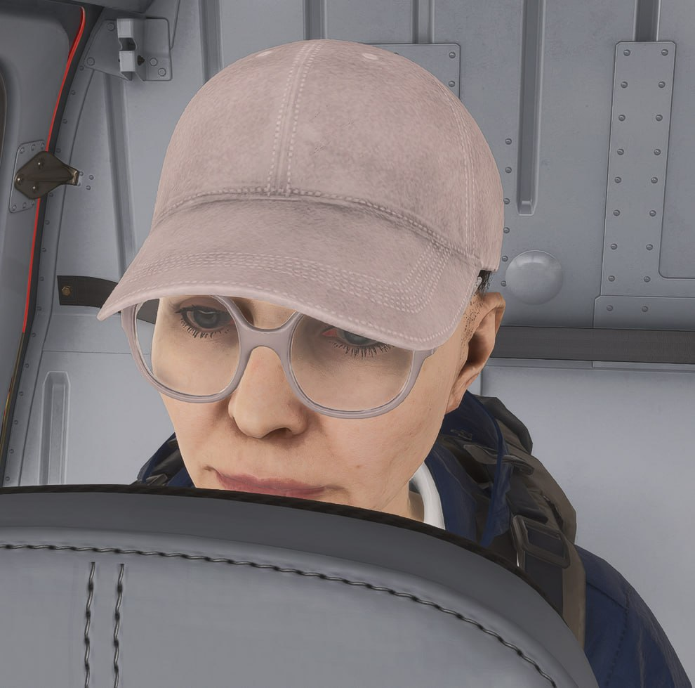
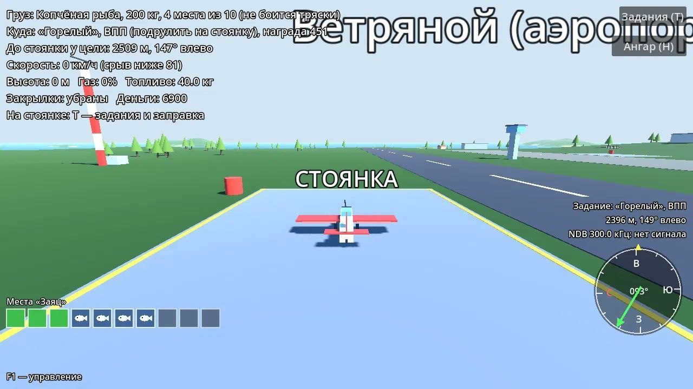
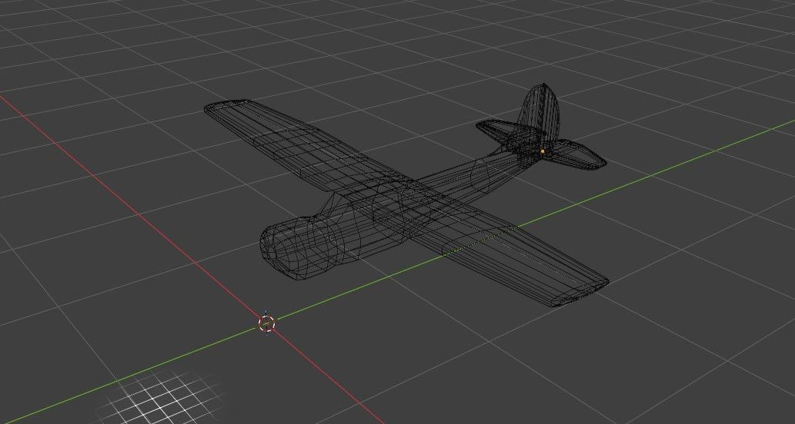
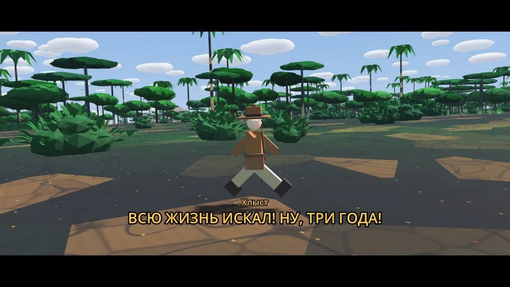

Я с детства виртуальный самолётчик. Начиная с АТАРЬЕВСКИХ скролл-шутеров (я хз, они правда так называются), заканчивая MFSM 2024 с получасовыми тыканьями в виртуальную приборную доску. Но чего не хватает всем этим крутым гражданским симам? Интерактивности. Еле-еле в 2024 флайсим запихали режим карьеры, но он получился не совсем таким, каким я его ждал. Если не считать кучу багов и странный баланс выплат (Асобовцы считают, что у всех — куча свободного времени, поэтому летай, копи, ведь тебе всё равно делать нехер), то в целом карьера получилась скучноватой. Нет погружения. Модельки персов страшные, интерактивности нет. А хотелось веселых полетов, орущих пассажиров (в бете они орали своими тупыми синтетическими голосами).

Wild Wings — аркада с продвинутой, в рамках аркады, физикой. Н

акатал я сначала кучу формул. Давай считать, как сделать так, чтобы все шло от мощности двигателя. Выводил формулы, косинусы, синусы, лол. Я физику писал на листе. Потом попёр изучать движок GODOT. Тыкал, читал документацию. Еле-как собрал что-то похожее на ландшафт. И заставил летать квадратик. Правда, полётом это было назвать очень тяжко, гг. МЕШИ, ХУЕШИ, и так далее. Для моего престарелого мозга, который на работе от цифр пухнет уже, вообще было тяжело понять. И ТУТ Я ОТКРЫЛ ДЛЯ СЕБЯ ВАЙБКОДИНГ, МУЖИКИ, ЧТО ЭТО ЗА СЛАДКИЙ ПЛОД. Claude был оплачен. Я киданул туда свой документ со словами. МУЖИК, я хочу игру про самолетики на движке Godot. Запили мне демку на основе моих записей. И он сделал! Почти сразу хорошо. Самолёт не могу в бочку, пришлось учить. Кароч, спустя пару вечеров мои крылья выглядели так:

И понеслась жара!

Я писал, тыкал, отменял, переписывал. Потом лазил в блендер, поправлял. ЭТО БЫЛИ ЧУДЕСНЫЕ ВРЕМЕНА. Идеи лились и, в итоге, вылились в демку с шестью биомами, на каждом из котором свои сюжетные линии, персонажи, товары.

Замоделил САМ ВРУЧНУЮ ОФИГЕТЬ Я КТО самолет — ЯК-12.  Потом вертолёт МИ-2. Понятно, что не точь-в-точь, и хорошо — криворукость спасёт от исков, лол.

ХЕЙТЕРЫ СКАЖУТ, ЧТО ЭТО ФОТОШОП ИЛИ ИНСТАГРАММ:

Потом появились живые персы, которые встречаются в сюжетах. Например, местный аналог любителя спрятаться в холодильнике:

Ой, да там много чего запилил. Потом ещё статейки выпущу.