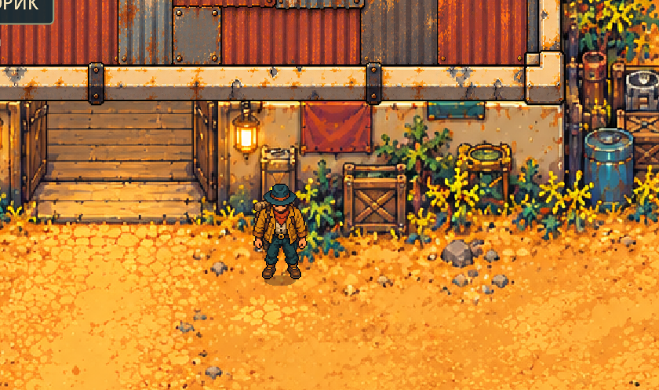
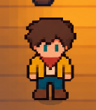
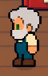

Балуясь в очередной раз с ChatGPT я написал ему, мол, брат, а давай браузерку запилим? Я тебе скормлю файл с правилами своей настолки — EASY D20, а ты мне в ответ что-нибудь играбельное. Нейронка долго не церемонится обычно. Сразу пошёл процесс. Побаловался я так денек, механики попридумывал, бои интересные сделал. И с дуру написал — а как это всё выглядело бы с НОРМАЛЬНОЙ ГРАФИКОЙ? Ну, не прям уж очень нормально — приличной.

ЖПТ мне вот такое накатал:

Да, красиво. Да, видно, что ЖПТ нарисовал, лол. Но такое, если поправить захочешь, то устанешь, удалишь фотошоп и пойдешь заниматься нормальными делами — играть в игры. 

Кароч, я говорю ему: давай, делай проще. 

И все деградировало до такого состояния:

Потом уже, на основе ЭТАЛОНА была создана первая сцена, диалоговая система со старичком:

Битва с роботом. И ПОНЕСЛАСЬ: РЕДАКТОР ПЕРСА, НАВЫКИ. Просто мозговой штурм, исписанные тексты документов с особенностями игры, с завязкой. Всё это кормилось, обрабатывалось. И в итоге получилось родить первую сцену на челноке, который везёт мужичков на работу, ЫЫ. 

Нейронки дарят таким лентяям, как я, возможность самому придумать и реализовать игру: были бы токены и время свободное.

Пилю потихоньку, пишу. И тестирую. Тестировать приходиться много. И это, похоже, самая нудная часть, если ты МОЩНЫЙ ВАЙБКОДЕР, ЛОЛ.

&nbsp;